<div align="center">
  <h1>CookWise AI</h1>
  <p><sub>KNOWLEDGE GRAPH&nbsp;·&nbsp;HYBRID RETRIEVAL&nbsp;·&nbsp;QUERY ROUTING&nbsp;·&nbsp;MULTI-TURN COOKING ASSISTANT</sub></p>
  <p>
    <a href="https://www.python.org/"></a>
    <a href="https://fastapi.tiangolo.com/"></a>
    <a href="https://neo4j.com/"></a>
    <a href="https://milvus.io/"></a>
    <a href="https://nextjs.org/"></a>
  </p>
  <p><b>English</b>&nbsp;&nbsp;·&nbsp;&nbsp;<a href="README_zh.md">简体中文</a></p>
</div>

## 1. Background & Goals

### 1.1 From Traditional RAG to Graph RAG

Traditional RAG relies on vector retrieval and parent-child chunking. It answers simple recipe queries, but falls short in a relation-heavy, constraint-rich cooking domain:

- **Missing relational semantics**: it cannot explicitly model relationships among recipes, ingredients, steps, and cooking methods.
- **Weak cross-document linkage**: it struggles to surface implicit links such as similarity or substitution between recipes.
- **Limited reasoning**: without multi-hop reasoning over a knowledge graph, compositional questions are hard to answer.

### 1.2 Core Advantages of the RAG System

Built around a Neo4j knowledge graph and augmented with vector retrieval, BM25, and query routing, CookWise AI is a production-oriented cooking assistant:

- **Structured knowledge**: the graph encodes entities and relations while preserving the original recipe text.
- **Hybrid retrieval**: graph retrieval, Milvus vector search, and BM25 run in parallel and fuse via RRF.
- **Query routing**: intent-aware evidence engines with multi-intent decomposition and parallel retrieval.
- **Controlled answers**: confidence gates, evidence validation, and fallbacks; the system states clearly when evidence is insufficient.
- **Production readiness**: multi-turn sessions, streaming, semantic cache, Redis rate limiting, and feedback logs.

## 2. Environment Setup

> Run all commands from the repository root; replace `localhost` with your server IP for remote deployment.

### 2.1 Create a Virtual Environment

```bash
conda create -n cookwise-ai python=3.11
conda activate cookwise-ai
```

### 2.2 Install Dependencies

```bash
pip install -r requirements.txt
```

> For offline unit tests only, install `requirements-test.txt`; torch, Neo4j, and Milvus are not required.

### 2.3 Neo4j Configuration

Neo4j is managed by [`docker-compose.yml`](docker-compose.yml) with image `neo4j:5.11-community`; APOC and GDS are enabled.

#### 2.3.1 Start Neo4j

```bash
docker compose up -d neo4j
docker compose ps
```

#### 2.3.2 Open Neo4j Browser

- **Web UI**: http://localhost:7474
- **Username**: neo4j
- **Password**: all-in-rag

#### 2.3.3 Import Data

`data/cypher` is mounted at `/var/lib/neo4j/import`. `neo4j-init` imports automatically when the database is empty:

```bash
docker compose up neo4j-init
```

It loads recipe, ingredient, and step nodes plus their relationships from `data/cypher/nodes.csv` and `relationships.csv`; it skips when the database is non-empty.

To re-import manually (the script MERGEs by `nodeId`, so it is repeatable):

```bash
docker exec -it cookwise-ai-neo4j cypher-shell -u neo4j -p all-in-rag \
  -f /var/lib/neo4j/import/neo4j_import.cypher
```

### 2.4 Milvus Configuration

Milvus Standalone and its etcd and MinIO dependencies are also defined in `docker-compose.yml`.

#### 2.4.1 Start Milvus

```bash
docker compose up -d milvus-etcd milvus-minio milvus-standalone
docker compose ps
```

#### 2.4.2 Build the Vector Index

On first startup, if collection `cooking_knowledge` does not exist, the backend builds it with BGE-small-zh-v1.5. To force a rebuild:

```bash
python scripts/rebuild_index.py
```

#### 2.4.3 Verify the Installation

```bash
docker compose ps                 # milvus-standalone should be healthy
curl -s localhost:9091/healthz    # returns OK
```

Milvus listens on `19530`; the MinIO console is at http://localhost:9001 (`minioadmin / minioadmin`).

### 2.5 Connection Settings

Copy the example file and fill in the required values:

```bash
cp .env.example .env
```

### 2.6 Start the Service

```bash
# Local backend (Neo4j / Milvus / Redis must be running first)
python main.py
```

Or launch the full container stack (backend, frontend, Nginx):

```bash
docker compose up -d --build
```

### 🌐 Access

Once startup completes, open:

- **🏠 Home**: http://localhost
- **⚛️ Frontend**: http://localhost:3000
- **🐍 Backend API**: http://localhost:8000
- **📊 Neo4j**: http://localhost:7474 (neo4j/all-in-rag)
- **🗄️ MinIO (Milvus storage)**: http://localhost:9001 (minioadmin/minioadmin)

## 3. System Architecture

### 3.1 Overall Architecture

The RAG system is modular and consists of the following core components:

```mermaid
flowchart TD

    %% ==================== Startup & Knowledge Base ====================
    subgraph BOOT["Startup & Knowledge Base"]
        START["main.py starts"] --> CONFIG["Load GraphRAGConfig<br/>Neo4j / Milvus / LLM / Redis"]
        CONFIG --> DEP_CHECK{"Dependency check"}
        DEP_CHECK -->|failed| BOOT_FAIL["Startup failed<br/>report the missing dependency"]
        DEP_CHECK -->|passed| INIT["Initialize 8 steps in dependency order"]

        INIT --> DATA["GraphDataPreparation<br/>Neo4j graph → recipe docs → chunks"]
        INIT --> INDEX["MilvusIndexConstruction<br/>BGE-small-zh-v1.5 / 512-dim"]
        INIT --> GEN_MOD["GenerationIntegration<br/>OpenAI-compatible LLM client"]
        INIT --> HYBRID["HybridRetrievalModule"]
        INIT --> GRAPH["GraphRAGRetrieval"]
        INIT --> ROUTER["IntelligentQueryRouter"]
        INIT --> CACHE["SessionCacheManager"]
        INIT --> LIMITER["RedisRateLimiter"]
        INIT --> RECIPE["RecipeRecommendationManager"]

        INDEX --> KB_CHECK{"Milvus collection exists?"}
        KB_CHECK -->|yes| LOAD_KB["Load the existing collection"]
        KB_CHECK -->|no| BUILD_DATA["Neo4j → recipe docs / chunks"]
        LOAD_KB --> LOAD_DATA["Load graph data<br/>build recipe docs / chunks"]
        LOAD_KB -.->|load failed, rebuild| BUILD_DATA
        BUILD_DATA --> BUILD_VEC["Create collection and build index"]
        LOAD_DATA --> READY["Init BM25 / graph index / retrievers"]
        BUILD_VEC --> READY
        DATA -.->|graph/document capabilities| LOAD_DATA
        DATA -.->|graph/document capabilities| BUILD_DATA
        READY --> APP["uvicorn starts the ASGI service"]

        CACHE --> REDIS_CONN["Redis connection"]
        LIMITER --> REDIS_CONN
        REDIS_CONN -->|unavailable, required=false| MEM_FALLBACK["Fall back to in-process sessions/cache<br/>rate limiting bypassed"]
        REDIS_CONN -->|unavailable, required=true| BOOT_FAIL
    end

    %% ==================== Web / API ====================
    subgraph WEB["Web / API Layer"]
        CLIENT["Browser / Next.js frontend"] --> NGINX["Nginx<br/>/ → frontend · /api → backend"]
        APP --> API["FastAPI app<br/>WebServiceHandler.create_app"]
        NGINX --> API
        API --> HEALTH["/health<br/>includes Redis ping"]
        API --> STATIC["Static files / SPA fallback"]
        API --> LIMIT{"Redis fixed-window rate limit<br/>default 60/min · chat 30/min"}
        LIMIT -->|exceeded| TOO_MANY["429 + Retry-After"]
        LIMIT --> CHAT_API["/api/chat"]
        LIMIT --> STREAM_API["/api/chat_stream<br/>SSE + [DONE]"]
        LIMIT --> RECIPE_API["/api/recipes/*"]
        LIMIT --> STATS_API["/api/stats"]
        LIMIT --> FEEDBACK_API["/api/feedback*"]
    end

    %% ==================== Chat Flow ====================
    subgraph CHATFLOW["Chat Flow"]
        CACHE_CHECK{"Semantic cache hit?<br/>same session · same topic<br/>similarity ≥ 0.75"}
        CACHED["Return the cached answer"]
        STATE["Load session state<br/>active_recipe / active_topic<br/>constraints / recent_user_queries"]
        ROUTE["IntelligentQueryRouter.route_query"]
        RESP{"response_type<br/>+ needs_retrieval"}
        CLARIFY["clarify<br/>ask a clarifying question"]
        DIRECT["chitchat / out_of_scope<br/>direct answer or fixed refusal"]
        NO_DATA["no_data<br/>state insufficient evidence"]
        ANSWER["answer<br/>enter the generation layer"]
        UPDATE["update_state_after_turn<br/>update active_recipe / constraints"]
        WRITE_CACHE["Write semantic cache<br/>skip no_data / clarify / refuse"]
        WRITE_CTX["Write session context"]

        CHAT_API --> CACHE_CHECK
        STREAM_API --> CACHE_CHECK
        CACHE_CHECK -->|hit| CACHED
        CACHED --> WRITE_CTX
        CACHE_CHECK -->|miss| STATE
        STATE --> ROUTE
        ROUTE --> RESP
        RESP -->|clarify| CLARIFY
        RESP -->|refuse or no retrieval| DIRECT
        RESP -->|no_data| NO_DATA
        RESP -->|answer with evidence| ANSWER
        CLARIFY --> UPDATE
        UPDATE --> WRITE_CACHE
        UPDATE --> WRITE_CTX
    end

    %% ==================== Query Routing Package ====================
    subgraph ROUTING["Query Routing Package query_routing"]
        UNDERSTAND["understanding.py<br/>LLM structured output → parse → one repair"]
        RULES["rules.py + slots.py<br/>rule routing / follow-ups / slot normalization"]
        UNDER_OK["Understanding<br/>intents / entities / slots / context"]
        KEYS["RouteKeySpec × 12<br/>evidence profile / engine / validator / thresholds"]
        POLICY["policy.py<br/>deterministic RoutePlan"]
        THRESHOLD["Confidence gates<br/>min_execute / retrieval_override / no_retrieval"]
        PLAN["RoutePlan<br/>single/multi sub-plan · top_k · depends_on"]
        EXEC["evidence.py<br/>dispatch by engine"]
        PARALLEL["Single sub-plan runs inline<br/>multi sub-plan Semaphore(4)<br/>gather preserves order"]
        VALIDATE["validators.py<br/>complete / partial / missing"]
        TEXT_RETRY["retry_hint=text<br/>one extra text search"]
        MERGE["Merge and dedupe<br/>keep sub_query metadata"]
        ANALYSIS["QueryAnalysis<br/>route_key / engine / response_type<br/>evidence_status / sub_evidence"]
        TELEMETRY["data/logs/route_decisions.jsonl"]

        ROUTE --> UNDERSTAND
        UNDERSTAND -->|success| UNDER_OK
        UNDERSTAND -->|failure| RULES
        RULES --> UNDER_OK
        KEYS -.-> POLICY
        UNDER_OK --> POLICY
        POLICY --> THRESHOLD
        THRESHOLD --> PLAN
        PLAN -->|clarify| CLARIFY
        PLAN -->|chitchat / out_of_scope| DIRECT
        PLAN -->|needs retrieval| EXEC
        EXEC --> PARALLEL
        PARALLEL --> VALIDATE
        VALIDATE -->|retry_hint=text| TEXT_RETRY
        TEXT_RETRY --> VALIDATE
        VALIDATE --> MERGE
        MERGE -->|all missing| NO_DATA
        MERGE --> ANALYSIS
        ANALYSIS -.->|QueryAnalysis| RESP
        ROUTE -.-> TELEMETRY
    end

    %% ==================== Evidence Engines ====================
    subgraph ENGINES["Evidence Engines (dispatch by SubPlan.engine)"]
        GE["graph_entity<br/>ingredients / step time / overview<br/>recommendations / nutrition / benefits"]
        GR["graph_relation<br/>graph_rag_search"]
        HY["hybrid<br/>three-way recall + RRF"]
        CO["combined<br/>text + graph in parallel"]
        TIPS["tips_*<br/>pairing / safety / technique / rule"]
        NONE["none<br/>no retrieval"]

        EXEC --> GE
        EXEC --> GR
        EXEC --> HY
        EXEC --> CO
        EXEC --> TIPS
        EXEC --> NONE
        GE -.->|empty graph result, fall back to text| HY
    end

    %% ==================== Retrieval Internals ====================
    subgraph RETRIEVAL["Retrieval Internals"]
        DUAL["Dual-level retrieval<br/>entity-level + topic-level"]
        VECTOR["Milvus vector search<br/>one-hop neighbor boost"]
        BM25["BM25<br/>jieba tokenization"]
        RRF["RRF fusion"]
        PARENT["Parent-document backfill<br/>enabled by default, configurable"]
        ROUND["Round-robin merge<br/>graph results first"]
        GQUERY["Graph query understanding<br/>entity_relation / multi_hop<br/>subgraph / path_finding"]
        MULTIHOP["Multi-hop traversal<br/>max 3 hops + hub pruning"]
        SUBGRAPH["Knowledge subgraph extraction<br/>max 200 nodes"]
        GREASON["Graph reasoning<br/>reasoning-chain validation"]
        RANK["Ranking by graph + lexical + type"]

        HY --> DUAL
        HY --> VECTOR
        HY --> BM25
        DUAL --> RRF
        VECTOR --> RRF
        BM25 --> RRF
        RRF --> PARENT
        GR --> GQUERY
        GQUERY --> MULTIHOP
        GQUERY --> SUBGRAPH
        MULTIHOP --> GREASON
        SUBGRAPH --> GREASON
        GREASON --> RANK
        CO --> HY
        CO --> GR
        CO --> ROUND
        HY --> ROUND
        GR --> ROUND
    end

    %% ==================== Generation Layer ====================
    subgraph GENERATION["Generation Layer"]
        GEN_DIRECT["generate_direct_answer<br/>chitchat / out-of-scope refusal"]
        NOEVID["generate_adaptive_answer<br/>no-evidence prompt"]
        SINGLE["Single intent<br/>one LLM call<br/>repair howto with ≥3 steps"]
        SECTION["Multi-intent<br/>section per sub-question"]
        ORDER["Up to 4 parallel generations<br/>emit in original order<br/>repair the first streaming howto section"]
        STREAM["Streaming<br/>SSE chunks"]
        NONSTREAM["Non-streaming<br/>complete JSON"]
        STREAM_FAIL["Streaming failure → non-streaming fallback"]

        DIRECT --> GEN_DIRECT
        ANSWER -->|single intent| SINGLE
        ANSWER -->|multi-intent| SECTION
        SECTION --> ORDER
        NO_DATA --> NOEVID
        SINGLE --> STREAM
        SINGLE --> NONSTREAM
        ORDER --> STREAM
        ORDER --> NONSTREAM
        NOEVID --> STREAM
        NOEVID --> NONSTREAM
        GEN_DIRECT --> STREAM
        GEN_DIRECT --> NONSTREAM
        STREAM -.->|failure| STREAM_FAIL
        STREAM_FAIL --> NONSTREAM
        STREAM --> UPDATE
        NONSTREAM --> UPDATE
    end

    %% ==================== Storage & Observability ====================
    subgraph STORAGE["Storage and Observability"]
        NEO4J_DB[("Neo4j<br/>Recipe / Ingredient / Step")]
        MILVUS_DB[("Milvus<br/>vector index")]
        REDIS_DB[("Redis<br/>session state / semantic cache / rate limit")]
        TIPSDOC[("data/tips<br/>pairing / safety / technique / meal selection")]
        LOGS[("data/logs<br/>route_decisions / feedback")]
        DATA_FILES[("data/recipes_with_images.json<br/>data/dishes recipe data / images")]

        REDIS_CONN --> REDIS_DB
        GE --> NEO4J_DB
        GR --> NEO4J_DB
        HY --> NEO4J_DB
        HY --> MILVUS_DB
        VECTOR --> MILVUS_DB
        DUAL --> NEO4J_DB
        TIPSDOC -.->|parse| TIPS
        RECIPE_API --> RECIPE
        RECIPE --> DATA_FILES
        FEEDBACK_API --> LOGS
        TELEMETRY --> LOGS
        HEALTH -.-> REDIS_DB
        LIMIT --> REDIS_DB
        STATE -.-> REDIS_DB
        CACHE_CHECK -.-> REDIS_DB
        WRITE_CACHE --> REDIS_DB
        WRITE_CTX --> REDIS_DB
        STATS_API -.-> REDIS_DB
        STATS_API -.-> ROUTER
    end

    %% ==================== Fallbacks and Error Handling ====================
    subgraph FAILOVER["Fallbacks and Error Handling"]
        F_LLM["Understanding failure → rule routing"]
        F_EVID["Insufficient evidence → text retry / no_data"]
        F_ROUTE["Routing execution error → hybrid<br/>evidence_status=fallback"]
        F_STREAM["Streaming error → non-streaming"]
        F_REDIS["Redis unavailable → in-process fallback / startup failure"]
    end

    UNDERSTAND -.-> F_LLM
    VALIDATE -.-> F_EVID
    ROUTE -.-> F_ROUTE
    STREAM -.-> F_STREAM
    REDIS_CONN -.-> F_REDIS

    %% ==================== Styling ====================
    %% Neutral group backgrounds; tinted nodes mark stages; links recede
    style BOOT fill:#fafaf7,stroke:#e1e0d9,stroke-width:1px,color:#52514e
    style WEB fill:#fafaf7,stroke:#e1e0d9,stroke-width:1px,color:#52514e
    style CHATFLOW fill:#fafaf7,stroke:#e1e0d9,stroke-width:1px,color:#52514e
    style ROUTING fill:#fafaf7,stroke:#e1e0d9,stroke-width:1px,color:#52514e
    style ENGINES fill:#fafaf7,stroke:#e1e0d9,stroke-width:1px,color:#52514e
    style RETRIEVAL fill:#fafaf7,stroke:#e1e0d9,stroke-width:1px,color:#52514e
    style GENERATION fill:#fafaf7,stroke:#e1e0d9,stroke-width:1px,color:#52514e
    style STORAGE fill:#fafaf7,stroke:#e1e0d9,stroke-width:1px,color:#52514e
    style FAILOVER fill:#fafaf7,stroke:#e1e0d9,stroke-width:1px,color:#52514e
    linkStyle default stroke:#9c9a92,stroke-width:1.1px

    %% Keep light fills; hue denotes stage only, kept low-saturation so text stays dominant
    classDef boot fill:#edf2f7,stroke:#64748b,stroke-width:1.4px,color:#0b0b0b
    classDef web fill:#eaf2fb,stroke:#2a78d6,stroke-width:1.4px,color:#0b0b0b
    classDef route fill:#d9e7f8,stroke:#2a78d6,stroke-width:2px,color:#0b0b0b
    classDef engine fill:#fceae3,stroke:#eb6834,stroke-width:1.4px,color:#0b0b0b
    classDef gen fill:#dff4ec,stroke:#1baf7a,stroke-width:1.4px,color:#0b0b0b
    classDef store fill:#f2f1ee,stroke:#898781,stroke-width:1.4px,color:#0b0b0b
    classDef fail fill:#f8e4e4,stroke:#d03b3b,stroke-width:1.6px,color:#0b0b0b
    classDef success fill:#ddf2dd,stroke:#0ca30c,stroke-width:1.4px,color:#0b0b0b

    class START,CONFIG,INIT,DATA,INDEX,GEN_MOD,HYBRID,GRAPH,ROUTER,CACHE,LIMITER,RECIPE,READY,APP,REDIS_CONN,LOAD_KB,LOAD_DATA,BUILD_DATA,BUILD_VEC boot
    class CLIENT,NGINX,API,HEALTH,CHAT_API,STREAM_API,RECIPE_API,STATS_API,FEEDBACK_API,STATIC web
    class LIMIT,TOO_MANY,BOOT_FAIL,MEM_FALLBACK,F_LLM,F_EVID,F_ROUTE,F_STREAM,F_REDIS fail
    class ROUTE,UNDERSTAND,RULES,UNDER_OK,KEYS,POLICY,THRESHOLD,PLAN,EXEC,PARALLEL,VALIDATE,TEXT_RETRY,MERGE,ANALYSIS,TELEMETRY route
    class GE,GR,HY,CO,TIPS,NONE,DUAL,VECTOR,BM25,RRF,PARENT,ROUND,GQUERY,MULTIHOP,SUBGRAPH,GREASON,RANK engine
    class CACHE_CHECK,CACHED,STATE,RESP,CLARIFY,DIRECT,NO_DATA,ANSWER,UPDATE,WRITE_CACHE,WRITE_CTX,GEN_DIRECT,NOEVID,SINGLE,SECTION,ORDER,STREAM,NONSTREAM,STREAM_FAIL gen
    class NEO4J_DB,MILVUS_DB,REDIS_DB,TIPSDOC,LOGS,DATA_FILES store
    class DEP_CHECK,KB_CHECK success
```



### 3.2 Core Modules

#### Graph Data Preparation (GraphDataPreparationModule)
- **Role**: loads recipes, ingredients, steps, and relationships from Neo4j; builds structured recipe documents and chunks.
- **Highlights**: preserves graph semantics; dual title/length chunking; chunks carry parent-document and section metadata.

#### Vector Index (MilvusIndexConstructionModule)
- **Role**: builds and manages the Milvus collection for semantic similarity search.
- **Highlights**: BGE-small-zh-v1.5 / 512-dim; HNSW + COSINE; drops and recreates the collection on rebuild.

#### Hybrid Retrieval (HybridRetrievalModule)
- **Role**: three-way recall (dual-level graph, Milvus vector, BM25 keyword) fused with RRF.
- **Highlights**: entity-level + topic-level retrieval; jieba tokenization; optional parent-document backfill.

#### Graph RAG Retrieval (GraphRAGRetrieval)
- **Role**: understands graph queries and adds multi-hop reasoning and subgraph evidence along relationship paths.
- **Highlights**: max 3 hops + hub pruning; up to 200 nodes per subgraph; graph-aware reasoning and ranking.

#### Intelligent Query Router (IntelligentQueryRouter)
- **Role**: turns a user question into a `RoutePlan`, fetches evidence per engine, and returns documents plus `QueryAnalysis`.
- **Highlights**: LLM structured understanding + rule fallback; 12 route keys; confidence gates; parallel multi-intent retrieval; evidence validation and text retry.

#### Generation Integration (GenerationIntegrationModule)
- **Role**: generates the final answer from retrieved documents and routing analysis, in streaming or non-streaming mode.
- **Highlights**: adaptive single/multi-intent; up to 4 parallel sections emitted in order; streaming falls back to non-streaming; howto step repair.

#### Session and Rate Limiting (SessionCacheManager + RedisRateLimiter)
- **Role**: maintains multi-turn session state, semantic cache, and Redis fixed-window rate limiting.
- **Highlights**: semantic cache keyed by session/topic; carries the active recipe and constraints across turns; degrades in-process or fails startup when Redis is unavailable.

#### Recipe Recommendations (RecipeRecommendationManager)
- **Role**: reads `data/recipes_with_images.json` and `data/dishes` to serve random recommendations, recipe details, and images.
- **Highlights**: bypasses RAG; returns random recipes; preference fields are reserved.

### 3.3 Data Flow

1. **Startup and data preparation**
   - Initialize the data, index, generation, retrieval, routing, Redis, and recommendation modules in dependency order.
   - Collection missing: Neo4j → recipe docs → chunks → build the vector index.
   - Collection present: load it, then load graph data and build docs/chunks.
   - Initialize BM25, the graph index, and retrievers; degrade or exit when Redis is unavailable depending on `REDIS_REQUIRED`.

2. **Query processing**
   - Nginx → FastAPI: rate limit, load session state, and return the cached answer on a semantic-cache hit.
   - `route_query`: LLM understanding + one repair, with rule fallback on failure; the policy layer emits a confidence-gated `RoutePlan`.
   - Fetch evidence in parallel by `engine` (graph_entity / graph_relation / hybrid / combined / tips / none), validate, then merge.
   - Generation emits one section for a single intent or multiple ordered sections; up to 4 run in parallel.
   - Update session state; write the semantic cache and context when eligible.

3. **Fallbacks and error handling**
   - Understanding failure → rule routing; insufficient evidence → text retry or `no_data`.
   - Routing execution error → hybrid retrieval with `evidence_status=fallback`.
   - Streaming error → non-streaming; Redis unavailable → in-process fallback or startup failure.

## 🛠️ Tech Stack

| Layer | Stack | Responsibility |
| --- | --- | --- |
| Frontend | Next.js 14 · React · Tailwind CSS · Zustand · Framer Motion | Rendering, state management, animation |
| Backend | Python 3.11 · FastAPI · uvicorn | API service, SSE streaming |
| Retrieval | Neo4j 5.11 · Milvus 2.3.2 · BM25 (jieba) | Graph multi-hop, vector semantics, keyword recall |
| Models | BGE-small-zh-v1.5 · OpenAI-compatible LLM | 512-dim embeddings, understanding, generation |
| State | Redis 7 | Multi-turn sessions, semantic cache, fixed-window rate limiting |
| Deployment | Docker Compose · Nginx | Orchestration, unified entry, reverse proxy |

**🍽️ Enjoy your culinary journey!** If this project helps you, please give it a ⭐️.

## 📄 License

Released under the [MIT License](./LICENSE).

Copyright © 2026 cookwise-ai contributors

### 🔓 Permissions
- ✅ **Commercial use** — use in commercial projects
- ✅ **Modification** — modify the source code
- ✅ **Distribution** — distribute original or modified code
- ✅ **Private use** — use privately

### 📝 Conditions
- **Keep the copyright notice** — include the original copyright and license notice in all copies
- **Keep the license** — include the MIT License in all copies

### ⚠️ Disclaimer
- The software is provided "as is", without warranty of any kind, express or implied.
- The authors assume no liability or responsibility.
